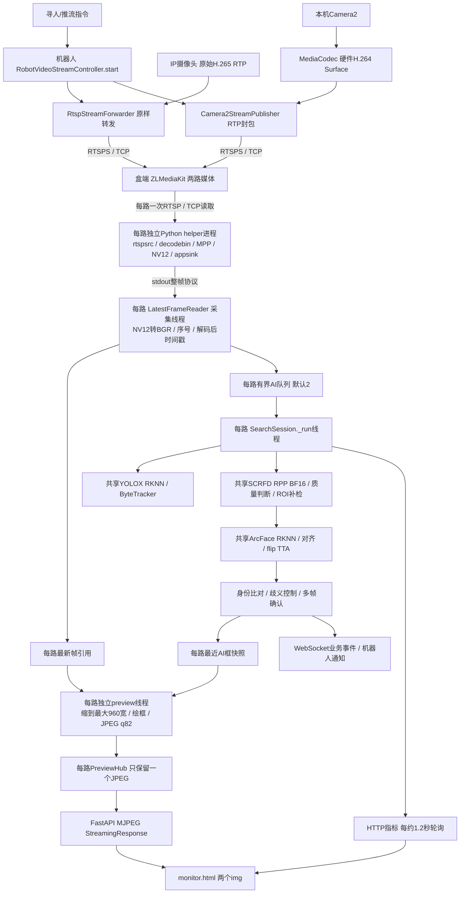

# RK3588 双路视频与人脸识别性能排查报告

日期：2026-10-14。范围：第一阶段代码审查、盒端只读采证、用户启动后的真实双路短时观测；未修改业务代码、模型、机器人参数或运行服务，未新增视频消费者。设备为 `.215`，不记录登录凭据、目标照片、向量或身份信息。

**优先结论：预览限频、采集受 AI 队列反压、统计定义错误均有直接证据。当前已经使用 MPP、RKNN 和 RPP，不能把问题简单归因为 CPU 软件解码或没有调用外置卡。先修这三个小范围问题，再做分段 A/B。**

本地工作树有大量既有未提交修改，全部保留。通过 SHA256 比较，运行容器 `/app` 的 `video.py`、`service.py`、`domain.py`、`config.py`、`gstreamer_capture.py`、`static/monitor.html`、`rpp_backends.py`、`rknn_backends.py` 和采集 helper 九个关键文件与本次本地审查版本一致。机器人 APK与机器人工作树的一致性未验证。

证据级别：**代码确认**指可确定的机制；**现场确认**指本次观测；**风险**指机制存在但因果/严重性需实验；**历史记录**只引用既有文档，不冒充本轮测试。

## 1. 当前系统实际架构



关键调用与证据（盒端路径相对本仓库；机器人路径相对 `~/WorkSpace/swcaresRobot`）：

| 环节 | 核心类/函数与位置 | 实际行为 |
|---|---|---|
| 机器人启动 | `app/src/main/java/com/swcares/robot/task/TaskCoordinator.kt:302` → `video/RobotVideoStreamController.kt:40` | 两种独立发布实例并行启动，生命周期共享 Mutex，不是逐帧公共锁 |
| IP摄像头 | 同前缀 `video/RtspStreamForwarder.kt:272`、`:340` | DESCRIBE/PLAY源 → ANNOUNCE/RECORD目标；原 RTP/RTCP转发，不解码/转码 |
| 本机摄像头 | 同前缀 `video/AndroidCamera2Source.kt:81`、`video/Camera2StreamPublisher.kt:235` | Camera2→编码器Surface→H.264→RTP封包→同步写网络 |
| API会话 | `src/person_search/api.py:190`、`service.py:3129`、`:2876` | manager按backend建模型；双路创建两个子SearchSession并共享模型对象 |
| 采集 | `video.py:120`、`:226` | 每路独立reader；RTSP可选OpenCV/FFmpeg或GStreamer helper，现场为后者 |
| 硬解 | `scripts/rk3588_gstreamer_capture.py:109`、`:177` | NV12路径用GI/Gst；自动decodebin或显式H.264/H.265 MPP；appsink单缓冲、drop=true、sync=false |
| 帧缓存 | `video.py:23`、`:44`、`:76`、`:149` | packet含frame_id、captured_at、source_epoch；AI队列和最新帧引用共用采集线程 |
| AI调度 | `service.py:1274`、`:1410`、`:1427`、`:1453`、`:1483` | 分频人体/全图人脸、预算ROI；质量门后对齐/提向量、比对、多帧确认 |
| 后端 | `hybrid_backends.py:78`、`:195`；`rpp_backends.py:307`；`rknn_runtime.py:327` | SCRFD走pyrt，ArcFace/YOLOX走librknnrt；共享执行资源加锁 |
| 预览 | `service.py:382`、`:404`、`:1779`、`:1858` | 独立线程读取latest，与最近AI快照叠加；同frame_id不重复编码，无观众不编码 |
| 视频/事件 | `api.py:393`、`:433`；`static/monitor.html:239`、`:599` | 视频为Python MJPEG，WebSocket传业务事件；无WebRTC视频路径 |

两路没有共用同一个AI工作线程，但位于同一服务进程、共享模型和执行锁。每路一个helper进程。没有发现预览另拉RTSP/另解码，也没有每个浏览器观众重复JPEG编码：观众共享已编码JPEG。ZLM存在RTSP/HLS/TS/RTMP/fMP4媒体表示，不等于机器人重复拉了五次流；现场每条RTSP媒体readerCount=1。HLS等没有观众但仍有输出字节计数，是否可关闭相关封装需先核查其他消费者和配置。

### 本次真实双路观测

用户启动任务后，2026-10-14 **14:19:51～14:20:37（北京时间）**读取16次状态，间隔约3秒，任务持续running；随后对媒体帧计数进行两个约5秒差分窗口。另有可复跑采集器及脱敏样本文件 `scripts/collect_dual_stream_audit.py`、`docs/dual-stream-audit-20261014.samples.jsonl`。

| 指标 | SOURCE 01 | SOURCE 02 | 解释/限制 |
|---|---:|---:|---|
| 图像/编码 | 3840×2160 / H.265 | 1280×720 / H.264 | ZLM track信息及服务分辨率一致 |
| ZLM声明FPS | 20 | 15 | 不直接当传感器实际FPS |
| ZLM视频frames差分/秒 | 20.16、19.90 | 14.17、14.33 | 媒体服务收到的视频帧计数，不是解码FPS；源码未审查其计数口径 |
| 前端“入流FPS” | 6.29～6.45 | 11.14～11.24 | 项目有缺陷的累计估计，明显不同于媒体入口计数 |
| 处理循环FPS | 5.53～5.66 | 7.92～8.06 | 从会话启动累计平均，不是本窗口瞬时FPS，也不是每帧检测 |
| 服务端Preview FPS | 3.32～3.99 | API未独立暴露 | 顶层值来自SOURCE 01，默认上限5 |
| 全帧人脸实际调用Hz | 2.39～2.44 | API未独立暴露 | SOURCE 01，配置4Hz，未达到8～12目标 |
| 人体实际调用Hz | 2.82～2.86 | API未独立暴露 | SOURCE 01，配置4Hz |
| 全帧人脸阶段P95 | 211～233ms | API未独立暴露 | 含前后处理、质量门与执行等待；不是纯硬件kernel |
| 人体阶段P95 | 231～242ms | API未独立暴露 | 含人体检测/跟踪等 |
| 预览制作阶段P95 | 92～95ms | API未独立暴露 | 含resize、绘制、JPEG、publish等 |
| 解码后→JPEG发布P95 | 约237ms | API未独立暴露 | 不含摄像头、机器人、RTSP接收/解码和浏览器呈现 |
| 解码后→AI结束P95 | 320～333ms | API未独立暴露 | 页面错误命名“端到端” |
| GOP间隔 | 约3.97～4.06秒，80帧 | 约1.04～1.06秒，15帧 | GOP不是固有显示延迟，但影响加入、丢参考帧后的恢复 |
| 媒体入口bytesSpeed | 约1.0～1.45MB/s | 约0.30～0.31MB/s | 短时码流/协议字节率，非设置码率；分别约8～11.6、2.4～2.5Mbps |

识别服务 `docker stats`一次瞬时读数CPU **186.98%**、内存 **1.009GiB**；ZLM CPU **19.05%**、内存 **216MiB**。CPU百分数约按单核100%计，不能理解为整机CPU已经满载，也不能替代长期线程采样。进程限制A76核4～7，采集helper和RPP server另有CPU消耗。`ps pcpu`为生命周期平均，只用于定位进程，不能当窗口利用率。单次TCP快照本地554两连接队列为0，不证明整链不存在短时拥塞/应用缓存。

**后续状态变化（不能混入上面的正常双路窗口）：14:22:12～14:22:24**，采集器保存的5个样本均显示SOURCE 01=`source_lost`，ZLM只剩local-camera，SOURCE 02保持running，媒体入口计数约14.65～15.25Hz。第一路累计processed_fps仍有4.68～4.88，顶层preview_fps=0，第一路阶段分位数停留历史值，conversion变为重连中的auto_pending。这验证了单源断开隔离与累计FPS对断流的误导；不能用第二个窗口的0预览断言第二路没画面。第一路媒体发布已消失，当前不能把它归因于AI或decoder；是否人工操作、机器人发布故障或源摄像头断线需机器人日志/用户操作时间确认。

日志进一步定位到 **14:21:49.249**：ZLM `RtspSession.cpp:62 onError`记录 `RTSP推流器(.../live/robot-01/ip-camera)断开:end of file`，连接持续253秒，ZLM看到的对端为本机回环地址。之后识别日志出现 `GStreamer capture frame timed out; reconnecting source`，ZLM播放器连接反复断开。能确认的是发布连接先消失、识别端随后重连；回环地址说明ZLM日志看到的是本地接入链的一端，不能据此直接断言机器人应用主动关闭或摄像头故障。需关联机器人、TLS/转发入口同一时刻日志，不重启服务试错。

**只读续查（14:33:40～14:33:46）**：第一路仍source_lost，第二路running、累计处理约8.59FPS、入口媒体计数约14.84～14.97Hz。第一路累计处理仍显示约1.38FPS，而实际无发布流，进一步证明累计数不适合实时在线判断。

盒端入口配置已读到：Nginx `18443`经`ssl_preread`按SNI将原始TLS透传到`127.0.0.1:7554`（ZLM RTSPS），其他HTTPS到`127.0.0.1:18444`。stream配置`proxy_connect_timeout 5s`、`proxy_timeout 1h`、`proxy_buffer_size 16k`、access_log off；这不是HTTP视频转码。已确认监控相关HTTP反代`proxy_buffering off`，因此不能无证据归因于已开启的HTTP代理缓冲。stream 1h超时不匹配此次253秒连接时长，不支持“固定5分钟Nginx超时”解释；其他故障仍未排除。ZLM配置rtsp.keepAliveSecond=15、protocol.continue_push_ms=15000，配置存在不等于本次由它触发。普通用户读取Nginx error.log被拒，未修改权限。

本窗口SOURCE 01只有一次embedding阶段/一张accepted face，ROI偶尔触发；**没有充分的多人完整识别负载样本**。不能将该阶段约125ms的单样本“P95”当稳定识别性能。SOURCE 02的阶段分位数、质量门、锁等待因API缺失尚不可单独取得。

## 2. 问题清单

| 编号 | 级别/状态 | 文件、函数与具体证据 | 影响 | 验证方式 |
|---|---|---|---|---|
| V01 | P0 已确认 | `config.py:261` preview_hz=5；`service.py:_preview_loop:427`按其sleep；现场值5 | 即使上游15/20FPS，预览最多约5FPS，直接违反目标 | 先保持图宽/精度，分档10/15/20Hz测发布和呈现、CPU、网络 |
| V02 | P0 机制确认 | `video.py:_capture_loop:149`检查AI queue.full→grab；`:171`淘汰旧packet并continue，`:192`更新latest被跳过 | 预览虽然独立线程，AI队列忙仍抑制新预览帧；实际损失幅度待A/B | 给AI可控延时，核对latest帧号与decode/previewFPS；改独立latest覆盖 |
| V03 | P0 已复现 | 同满队列分支丢当前grab帧和旧queue帧，只有一次on_drop | AI漏帧2记1；source_fps/drop_rate不可信 | mock 3输入/2read/1grab→队列剩1，drop仅1；修分开计数 |
| V04 | P0 已确认 | `domain.py:613,625,653` processed=frame_count/elapsed，source=(processed_count+drop_count)/elapsed | “入流”不是摄像头/接收/解码FPS；处理不是检测FPS；累计平均掩盖瞬时停顿 | 直接独立计数、10秒滑窗；与ZLM计数差分对照 |
| V05 | P0 已确认 | `service.py:MultiSourceSearchSession.view:3055`复制第一路，只求和processed/source/drop | 第二路阶段/预览/延迟不可观察，顶层drop_rate还来自第一路却配总drop | 每源完整诊断；总览不拼接不同范围值、不平均P95 |
| V06 | P0 已确认 | `video.py:188`在read完成后标captured_at；`service.py:1738`计end_to_end；页面`:356`称端到端 | 未测解码前或浏览器延迟，容易误判已<500ms | 更名盒内延迟；光学时钟/LED完整E2E测量 |
| V07 | P0 优化约束确认 | compose`:61`人体/人脸各4Hz；现场人脸约2.4Hz；`service.py:1322`读取加速配置 | 现配置本身不追求每路8～12次全图检测，改loop_hz不能直接解决 | 测effective_hz和不同帧检测计数；逐档调频且精度/资源同验 |
| V08 | P0 延迟风险 | compose`:71`/`config.py:275` jitter latency500、dropfalse；helper`:193`仅appsink单缓冲 | 500ms jitter预算已占目标主要部分；appsink丢旧帧不能清理所有上游缓存 | 500/300/150/100ms隔离A/B，测绿帧/丢包/重连/E2E；不盲开drop |
| V09 | P1 现场确认 | `gstreamer_capture.py:_select_fastest_converter:155`颜色误差>3回退；现场reason="RGA color output disagrees with OpenCV" | 第一路转换实际OpenCV；RGA设备存在、库加载不等于转换采用硬件 | 保存小样本，核查色彩矩阵/range/stride/RGA精度，不能删除校验或放宽阈值冒充修复 |
| V10 | P1 共享机制确认/瓶颈待量 | `rpp_backends.py:307`全局锁含copy/execute/readback；RKNN runtime`:327`上下文锁；双路共模型 | 双路会竞争模型；阶段P95可能包含锁等待，不能直接删除安全锁 | 锁前/后时间独立计数，单路/双路A/B；必要时公平调度 |
| V11 | P1 代码确认 | `service.py:1471`所有质量和预算通过脸提embedding，confirmed只降低排序优先级`:2123` | 存在已确认身份重复提特征的优化空间 | 按track受控复核间隔，遮挡/换人/低置信度/丢失强制复核；测串线 |
| V12 | P1 代码确认 | `rknn_backends.py:399`按脸run，启用flip再run；`service.py:2147`microbatch为chunk | 不是真NPU batch；人多时成本增长，不能以关闭TTA无条件换FPS | 统计人脸数、vector数、实际run数、每脸耗时；保持embedding contract |
| V13 | P1 代码确认/影响待验 | `service.py:1416`tracker仅person_due更新；`tracker.py:47`速度按update次数，无真实dt；预览快照`:430`无对应frame/time | 跳帧/调频/相机运动可能ID变化；新画面叠旧框，无每预览帧连续跟踪 | 测移动/遮挡/调频ID continuity、框年龄、抵近目标位置可靠性 |
| V14 | P1 观测缺口 | `domain.py:614`仅阶段P95；stage包含多个操作；无queue长度/锁等待/纯align/compare | 无法可靠分段归因；P50/max没有数据，不能用P95序列二次算调用P50 | 增加有界阶段采样P50/P95/max/count，注明窗口/单位 |
| V15 | P1 待现场定位 | helper`:142`buffer→bytes→stdout；bridge`_read_exact`聚合；原分辨率BGR、预览CPU resize/JPEG | 4K全帧copy/pipe/转换负担；高预览频率可能加CPU/内存带宽压力 | 分别测原NV12/转换/resize/copy/编码；先测再设计共享内存 |
| V16 | P1 传输风险 | `api.py:407` MJPEG响应；前端`:239`img；最近JPEG无法撤回已进入TCP/代理缓冲的旧帧 | Preview FPS只证明发布，不保证浏览器呈现实时 | 慢客户端+光学延迟，查代理buffer配置/吞吐；必要时换传输 |
| V17 | P0 现场确认 | `domain.py:607`会话累计frame_count/elapsed；14:22 SOURCE 01已source_lost仍报约4.7～4.9FPS | 断流显示历史速率，若只看FPS会误判仍在进展；阶段P95也可能陈旧 | 10秒滑窗+最后帧时间/采样数/stale标记；断流速率及时归零而保留累计历史 |
| R01 | P0 排查风险 | 机器人`video/RtspStreamForwarder.kt:340`read→write；`Camera2StreamPublisher.kt:235`编码drain→发包 | 网络写慢会停止上游读或编码drain；缓存可能在TCP/相机/编码器 | robot write/drain P50/P95/max、TCP队列/重传；不任意丢压缩参考帧 |
| R02 | P1 代码确认/收益待量 | 机器人`video/RtspProtocol.kt:123`逐RTP包flush | TLS小写入成本可能增加，不等于已证明主瓶颈 | 受控按access unit有界聚合实验，保证RTCP/控制消息顺序 |
| R03 | P1 可配置性确认 | `RobotVideoStreamController.kt:157`沿用本机720P/15FPS/2Mbps；`task/RobotTask.kt:216`消息无编码参数 | 盒端改resize不能改源码率/4K解码负担，调度消息不能直接调本机编码 | 先查camera支持范围，再增加版本化受约束配置；IP camera需厂家接口 |
| R04 | P0 测量风险 | 机器人`H264RtpPacketizer.kt:51`RTCP映射基于发包时刻；Camera2 AE选包含FPS范围 | RTP/RTCP不直接保证可信sensor采集时刻或固定15FPS | CaptureCallback/sensor timestamp、编码PTS计数与可信wall映射；光学法 |
| R05 | P0 发布中断现场确认/原因待验 | ZLM日志14:21:49.249记录ip-camera发布连接EOF，随后媒体消失且SOURCE 01重连；SOURCE 02继续 | 第一路稳定性尚未通过；不是仅凭AI低FPS能解释的现象 | 关联机器人源读取/发布写入、TLS接入/转发和用户操作时间；不能只靠重启识别服务 |
| R06 | P0 机器人代码确认 | `RtspStreamForwarder.kt:202`设置FAILED；`RobotVideoStreamController.kt:204`私有封装仅start/stop/close，没有collect status；`TaskCoordinator.kt:315`只ACK启动结果 | 运行中故障没有原因/方向状态上报；盒端仅看到流离线，不能定位触发侧 | 受控上游EOF/目标EOF/超时，断言发送source_id、phase、故障码及首个异常类别，不带URL/凭据 |
| R07 | P0 机器人代码确认 | `RobotVideoStreamController.kt:49`仅task/source/fingerprint判allAlreadyRunning；`:60`入running，运行中FAILED不移除 | 同参数重试可能ACK成功却未重建任何连接；盒端拉流重连不能恢复机器人已停止的发布 | 模拟首次成功→上游断开→同参数重试，必须出现新DESCRIBE/ANNOUNCE；token变化不属于同参数用例 |
| R08 | P1 keepalive风险 | `RtspStreamForwarder.kt:331`取两端keepAliveMs最小值统一发OPTIONS；`RtspProtocol.kt:90`下次发时pending未清即失败；writeFrame和keepalive同锁 | 两端超时不同或网络写阻塞时，响应可能被过早判超时；尚无本次发生证据 | 记录双方SETUP timeout、OPTIONS CSeq/发送响应时间/状态码、写入与锁等待；不记录鉴权头/SDP |

未发现无限增长AI视频队列：默认maxsize=2；统计数组最多1000；PreviewHub单JPEG；每源frame_id递增且重连有epoch。现有get按FIFO取一帧，不是原子取最新；queue=2有短期旧帧，满队列策略还会抑制预览。没有证据证明AI重复消费同一个packet；框快照重复使用与重复检测原帧要区别。

GStreamerCapture.grab仍读取完整NV12输出，**不省VPU解码**，只省BGR转换；OpenCV grab是否省解码也不能按注释认定。队列清理不解决机器人/TCP/jitter/解码器/浏览器全部缓存。

## 3. 硬件利用情况

| 资源 | 本次结论 | 证据/未决项 |
|---|---|---|
| CPU | 确认用于转换、resize、quality、NMS、对齐、比对、跟踪、JPEG和IPC | live识别服务瞬时187% CPU；未获得长期P50/P95/温度趋势，不能宣称CPU饱和 |
| VPU / MPP | **两路实际使用MPP有强证据** | 两个活跃helper均映射libgstrockchipmpp/librockchip_mpp，并打开/dev/mpp_service与dma_heap；插件1.14.4、rank257。现auto decodebin，仍建议每次启动报告实际decoder名称；4K不应归为纯软件解码 |
| RGA | 设备和库可用，但SOURCE 01 NV12→BGR **已回退OpenCV** | /dev/rga被API打开；颜色验证失败reason已现场取得；SOURCE 02无独立状态，待验证。未知解码器内部是否另用RGA，不能从主转换回退否定所有RGA调用 |
| RK3588 NPU | ArcFace与YOLOX路径确认加载并使用RKNN接口 | readyz provider RKNN_NPU；API映射librknnrt、打开/dev/dri/card1；live人体阶段持续调用。YOLOX core_mask_applied=true；ArcFace三核实际生效需单独确认，现hybrid面板face=null不代表没用NPU。利用率debugfs未取得，不擅自mount/chmod |
| RPP外置加速路径 | 已发现并确认SDK/驱动/PCIe路径；不是“代码完全没有调用” | API加载pyrt、live face_full执行；rpp模块加载、rpp_server运行；PCIe 0000:01:00.0 id1f2e:00c1，driver RPP，当前5GT/s×4。商业型号、厂家、SDK版本和标称19TOPS对应关系仍需设备铭牌/厂家证据 |

容器 `person-search-rk3588-rpp:streamcontract-20261014` healthy、restart count=0；revision同名、Linux5.10.198/aarch64、cpuset4～7、ipc:host。现backend=hybrid；SCRFD搜索 `det_10g.onnx`专门化1280×736，登记640×640，RPP BF16；ArcFace `w600k_r50.rknn` 输入112×112、512维、flip TTA；YOLOX `yolox_tiny_640x384.rknn`。4K是前后处理原图，检测网络输入不是4K tensor。

ONNX备用路径 `backends.py:78`用FaceAnalysis buffalo_l，仅detection/recognition，选择可用CUDA或CPU EP；它不天然支持RK3588 NPU。项目已通过自定义RKNN runtime与后处理适配，不需要从零再移植。静态RKNN文件名中的INT8不意味着当前RPP图是INT8。不得将6+19TOPS当同一个模型25TOPS，RPP与RKNN是工作负载路由。

历史基准 `docs/rk3588-rpp-container.md:174`（2026-10-11，另一次测试）：搜索SCRFD RKNN P50 40.93ms，RPP 95.36ms；4K上采样单图YOLOX+SCRFD并行RKNN 131.45ms、hybrid183.27ms。比较包含不同精度和传输路径，且仅12次单图，不是本盒本轮视频/准确率结论。应据此安排A/B，不能宣称外置卡更快。历史53/53人脸框匹配、ArcFace少量裁剪一致性亦不足以完成业务精度验收。

## 4. 性能瓶颈分析与指标设计

| 链路 | 已知事实与最可能风险 | 所需验证 |
|---|---|---|
| RTSP源→机器人→ZLM | 4K入口约20媒体帧/秒而页面约6；机器人同步转发，GOP约4秒；真实sensor FPS未取 | 上游编码PTS/厂家输出计数、robot写入时间、同一画面的光学E2E；源20不能当解码20 |
| 解码→盒端BGR | 两路MPP，NV12跨进程全帧传输；4K颜色转换回退CPU | VPU输出PTS/帧号差分、pipe传输/转换P50/P95/max，单/双路无AI实验 |
| 帧缓存 | 有界AI队列满时采集skip且latest不更新，计drop漏一帧 | 可控慢AI下预览与采集独立性；queue长度与覆盖数；禁止从有界推断无上游滞后 |
| 检测 | SOURCE 01 full-face约2.4Hz，stageP95约211～233ms；共享锁、4Hz设置 | 分离resize、H2D、锁等待、execute、D2H、NMS/quality；公平性与单/双路对照 |
| 对齐→识别 | 五点对齐/FP16 ArcFace/翻转TTA，按脸逐次，已确认脸仍可能重复 | 多人/清晰正脸场景，align、每脸embedding、run次数，复核缓存收益与身份可靠性 |
| 比对→业务确认 | normalized dot product/ranking，多帧质量/间隔/投票/aggregate/歧义门 | 比对与确认独立计时，漏认/误确认/time-to-confirm/track ID continuity |
| 绘图/JPEG/推送 | 独立线程但当前5Hz上限；4K缩到960宽制作P95约94ms | 提频梯度CPU/bytes/每源发布FPS；输送慢客户端与代理buffer验证 |
| 浏览器 | MJPEG img，无呈现计数；AI快照可能旧于当前图 | 光学帧龄、可辨唯一帧号、浏览器网络与呈现丢帧；必要时升级播放器 |

优先级最高的已知体验限制是 **5Hz预览上限与AI反压采集**。4K全帧转换/复制、双路模型锁和500ms jitter预算是需分段实验的重点。现有证据不能证明“MPP解码本体慢”或“ArcFace是主要瓶颈”。

统一指标应每源独立，注明10秒滑窗、累计计数和最近1000次阶段分位数的不同口径：

| 指标 | 新定义/采集点 |
|---|---|
| Source FPS | sensor/encoder实际新帧计数，来自机器人/厂家；无法取得标unknown |
| Media Receive FPS | ZLM视频frames差分；标明服务口径，不与source混用 |
| Decode FPS | decoder成功输出的不同帧数/秒，保留PTS/本源序号 |
| BGR FPS | 完成BGR转换的新帧数/秒，与跳过转换分别计数 |
| Detection FPS | full检测过的不同源帧号/秒；ROI帧率、ROI次数、多尺度实际run另计 |
| Recognition FPS | 人脸embedding成功数/秒，attempts、failures、TTA实际run数分别计 |
| AI Loop FPS | 原processed_fps，更名以避免冒充Detection FPS |
| Preview Publish/Receive/Present FPS | 分别统计JPEG发布、客户端收到、实际呈现；当前只取得publish |
| Latency | read/convert/preprocess/锁等待/H2D/run/D2H/postprocess/align/embed/compare/draw/JPEG/send，P50/P95/max/count |
| Queue/Dropped | 各队列当前/峰值；AI覆盖、跳过转换、decoder掉帧、客户端跳帧按原因分计 |
| Frame Age | 可信sensor时间到呈现；若仅本机时间，明确“解码后→发布”或“解码后→AI结束” |
| CPU/内存/设备 | 每进程和线程窗口利用率、RSS/峰值、温度、频率、设备load（支持才取） |

跨设备不能直接相减monotonic；PTS是媒体时间，未经RTCP/时钟映射验证不等于采集UTC。本机Camera2 RTCP发包时间映射也不是sensor时刻。推荐拍摄毫秒时钟/LED变化，同时录下实物与浏览器画面，离线逐帧算延迟（测量相机采样误差需记录）。有可靠NTP/PTP/采集时间映射后再做软件E2E统计。不能将500ms jitter与237ms/333ms不同分位数直接相加得出准确E2E。

现有准确率控制：`quality.py:64`尺寸/score、`:79`Laplacian模糊/亮度、`:92`登记姿态硬门；搜索姿态影响质量排序，非同样硬门。`confirmation.py:494`唯一帧/最小采样间隔，`:703`样本数/统计量/票数/aggregate；存在身份歧义和tiny-face shadow机制。后续不得降低相似度阈值、减少全图召回或取消多人ROI来制造更高循环FPS。

精度回归需用同一批原始视频/登记照，覆盖同人/异人、远中近、尺寸分桶、正侧脸/低头、运动/遮挡/曝光、多人交叉、重连、机器人运动和压缩程度。记录检测召回、关键点/对齐差、向量一致性/同异人分布、误确认/漏确认、确认耗时、ID switch及错误抵近通知。`evaluation.py:11`现政策召回0.9、误确认0.01/h、负例100h是配置标准，不代表已经有足够数据；需业务定案并报告统计置信区间。降分辨率/量化/换后端/TTA/复核节流分别单变量回归，不以单张成功图验收。

## 5. 最小优化方案（按优先顺序）

| 顺序 | 小范围方案 | 成本/兼容性 | 预期收益 | 风险与验证 |
|---|---|---|---|---|
| 1 | 增加独立采集/解码/转换计数、准确drop及每源完整诊断；修指标名 | 低；保留旧字段并增加明确新字段，避免破坏调度契约 | 能正确归因和比较，不保证直接提速 | 指标范围/并发锁开销；计数守恒与双路不同负载测试 |
| 2 | 有预览观众时独立更新latest；AI满时只覆盖最旧任务；AI取最新且带frame_id/epoch/时戳 | 低至中；沿用reader/PreviewHub/线程 | AI慢不再主动压低预览新帧，缩短AI任务年龄 | 更多BGR转换CPU成本；无观众可保留省转换策略。实际不同帧计数、慢AI/重连/stop与跟踪回归 |
| 3 | 在受控实例中preview_hz分档5→10→15→20，先保留宽960/q82 | 配置低；现场需启动新实例/受控重启，当前未改 | 直接解除5FPS人为上限 | CPU、JPEG/网卡/代理压力；要以浏览器呈现与E2E验证，20不是保证 |
| 4 | 给框快照加来源frame/time与最大age策略 | 低；身份确认不改 | 避免旧框被当作当前位置 | 隐框时业务观察变化；运动目标/机器人抵近验证 |
| 5 | jitter分档测试，先不改dropfalse；各路H.264/H.265分开测试 | 低；旧插件已有属性 | 降低RTSP延迟预算 | H.265参考帧晚到可绿帧，保持可回退基线；真实弱网/长时稳定测 |
| 6 | 定位RGA颜色不一致，明确range/matrix/stride及输出精度，修实现后重新择优 | 中；保持自动CPU安全回退 | 可能减少转换CPU，是否更快需本机测 | 不能取消颜色门；多分辨率/光照数值和识别回归 |
| 7 | 已确认track按间隔/质量/置信度复核，不重复所有特征 | 中；不改embedding contract/阈值 | 多人减少ArcFace重复run | 身份串线、遮挡后换人风险；保留强制复核触发与多帧确认 |
| 8 | 当前hybrid对已有纯RKNN做隔离同输入A/B，并测锁等待、公平性 | 中；已有backend可配置，无需重写SDK | 找实际更快且合格的路由 | INT8/BF16精度差、登记契约、RPP稳定性；不在线额外加载模型施压 |

队列实现采用每源最新slot或maxsize1覆盖都可，但必须原子管理覆盖计数，不靠粗暴清空压缩流。AI和preview可以共享同一不可变BGR引用，无需重复RTSP解码；如增加独立小预览转换，应量化额外颜色转换成本。调高`target_loop_hz`只改变ROI预算信用，不能当循环sleep上限。先保持模型尺寸、threshold、TTA、全图召回和ROI容量，逐项看证据。

续查后的机器人最小可靠性方案：先让RunningStream公开受限phase与故障通知，控制器在匹配当前实例/任务generation时移除FAILED条目，幂等早退同时验证真实活跃状态。保留启动成功ACK，新增运行状态事件，携带source_id、source/destination/keepalive/watchdog故障分类、首个异常类型、最近媒体/保活时间；不得记录凭据/完整URL。如果需要自动重连，应按单路、有界退避、任务有效期/令牌有效期/取消信号执行，不能无条件重启两路或在任务结束后继续发布。先修状态可见性和重试语义，再由实测决定重连策略。

253秒断流可由源读EOF、目标读EOF、媒体15秒无成功转发、保活pending/状态码/CSeq失败、未知RTP通道、显式单源stop等触发；任一子循环finally关闭该路两个socket，但不会停止独立本机发布器。不能仅凭接近默认5分钟归因于时长限制：控制器用命令时长覆盖类默认值，调度源码`airport-robot-dispatch/backend/app/services.py:834`发送1800秒；实际APK/消息仍需确认。机器人当前不自动重连，调度`_video_sources_status:737`会显示媒体offline，但并不提供机器人首个失败原因。

## 6. 架构升级建议（最小方案不足时）

当前已有ZLM/MPP/RKNN/RPP，升级重点是验证和调度，不是重复安装一套。MPP仅在确认auto选择不稳定时按各路实际codec固定解码器并记录Gst元素/PTS；不要全局设h265造成第二路h264失败。RGA应验证真实输出和收益；共享内存/DMABUF可减少stdout全帧复制，但Python生命周期、stride、格式和SDK兼容成本更高。

若MJPEG测得传输/浏览器延迟或CPU编码成为瓶颈，可复用现有ZLM评估WebRTC视频通道，WebSocket发送带source/frame/time的AI结果，前端按映射叠框。需要验证H.265浏览器兼容性、协商、TLS、网络可达、音视频时间映射和是否新增转码负担；不用为引入新技术强制重构。

若共享锁等待占主因，可做模型公平异步调度、检测/识别分频与有界latest任务；不要直接取消RPP全局锁或复制多套不具线程安全保证的context。NPU true batch需要静态图/算子/SDK支持，与当前chunk不同。外置卡具体商业型号/SDK版本/支持算子须厂家资料核对，当前pyrt对专门化ONNX有实际支持，不能外推全部ONNX/ArcFace都快。

机器人IP摄像头参数需厂家/ONVIF/ISAPI或SDK能力确认，目前原样转发代码不能改其输出。可测试1080P/20FPS/H.264/约3Mbps/1秒GOP/低延迟，保持原配置可回退并验证远小脸；本机Camera2代码已有硬件H.264、优先CBR、Baseline、请求0B帧/1秒GOP，当前默认720P/15FPS/2Mbps，需实机核对协商输出。调度消息无参数字段，不能只改服务端以为机器人已调整。主子码流仅发现URL透传，未见自动选择：可预览子流+AI主流，但增加第二消费者/解码及双流框坐标/时间对齐成本，先算资源收益。

## 7. 可执行排查命令

以下在盒子执行，均不安装、不改权限、不重启。不输出整份docker inspect/env或ZLM配置，避免泄露密钥。命令存在版本差异时报告“不支持/无权限”，不要自动安装工具。

```bash
# 系统/版本/当前负载；不证明视频时延
date -Ins
uname -a
uptime
free -h
docker ps --format '{{.Names}} {{.Image}} {{.Status}}'
curl -fsS --max-time 5 http://127.0.0.1:18080/healthz
curl -fsS --max-time 5 http://127.0.0.1:18080/readyz

# CPU/内存窗口快照；host网络模式NET=0不代表没网络传输
docker stats --no-stream --format '{{.Name}} CPU={{.CPUPerc}} MEM={{.MemUsage}}'
ps -eLo pid,tid,comm,pcpu,stat --sort=-pcpu
# ps pcpu是累计平均，进一步使用top/pidstat窗口采样；先由docker top取得PID
docker top person-search-rk3588-rpp -eo pid,comm
# 将下面PID替换为上条命令中的API/helper实际PID，不包含完整命令行
top -H -b -d 1 -n 5 -p PID
# 如果已安装sysstat：记录线程CPU；不要为检查擅自安装
pidstat -t -p PID 1 10

# 已有TCP队列、RTT/重传（连接地址属于运行信息，分享前脱敏）
ss -tin '( sport = :554 or dport = :554 )'
ip -s link

# 硬件枚举和驱动，只读
lspci -nnk
lsusb
lsmod
ls -l /dev/mpp_service /dev/rga /dev/rpp0_entire_ctrl /dev/ve0_entire_ctrl
ls -l /dev/dri /dev/dma_heap
readlink /sys/bus/pci/devices/0000:01:00.0/driver
cat /sys/bus/pci/devices/0000:01:00.0/current_link_speed
cat /sys/bus/pci/devices/0000:01:00.0/current_link_width

# MPP/RGA/GStreamer组件存在与属性；不是实际硬解执行证明
gst-inspect-1.0 --version
gst-inspect-1.0 mppvideodec
gst-inspect-1.0 rtspsrc
gst-inspect-1.0 appsink
ldconfig -p | rg 'rknn|rockchip_mpp|rga'
ffmpeg -version
ffmpeg -hide_banner -decoders
# 若ffmpeg不存在或没有Rockchip解码器，不否定GStreamer MPP

# 加速load：只读已有节点，无权限/不存在即记待验证，不mount debugfs、不chmod
cat /sys/kernel/debug/rknpu/load
cat /sys/kernel/debug/rkrga/load
# 温度与频率（节点按设备实际发现，不写governor）
cat /sys/class/thermal/thermal_zone*/temp
cat /sys/devices/system/cpu/cpufreq/policy*/scaling_cur_freq
```

本次采集器只GET active状态和ZLM媒体列表；ZLM密钥在内存使用且不输出，只导出白名单指标，不输出搜索ID/源URL/目标信息。在本仓库Mac执行下面命令，把脚本通过stdin交给盒子Python，不在盒子写文件，不增加拉流消费者：

```bash
ssh -o BatchMode=yes -o ConnectTimeout=5 EIS100RK3588@192.168.17.215 \
  'python3 - --samples 20 --interval 3' \
  < scripts/collect_dual_stream_audit.py > /tmp/dual-stream-audit.jsonl
```

需用户有现有SSH鉴权与docker读取权限；不把密码放参数。登录banner可能混入stdout，分析时只接受有效JSON行。也可在盒端已有脚本目录运行 `python3 collect_dual_stream_audit.py`；容器/配置路径不同可用`--zlm-container`或`--skip-media`，前者读取当前 `/opt/media/conf/config.ini`，错误仅输出异常类型。采集器会消耗少量API/JSON统计CPU，默认每3秒，不高频刷接口。

实际硬解证据可以在容器内用Python读取自己的/proc，检查每个helper映射库及打开mpp/dma设备。本轮已完成。宿主普通用户读/proc曾PermissionError，已改在现有容器内只读，未改权限；NPU debugfs未成功取值。`/readyz`只证明初始化和报告的provider，不单独证明长时推理/利用率。

需要新消费者的操作安排测试窗口：**ffprobe/gst-launch/benchmark都会增加网络或设备负载，不能在本次寻人任务中悄悄运行**。仅对不含凭据的盒内媒体URL，在隔离窗口执行，例如：

```bash
# 声明codec、尺寸、帧率；r_frame_rate/avg_frame_rate不是实际接收FPS
timeout 15s ffprobe -v error -rtsp_transport tcp \
  -select_streams v:0 \
  -show_entries stream=codec_name,width,height,r_frame_rate,avg_frame_rate \
  -of json rtsp://127.0.0.1:554/live/robot-01/ip-camera
# 若timeout/ffprobe未安装，跳过；不要自动安装
```

分段硬解无AI测试应分别检查无转换NV12 appsink、增加转换、增加预览后FPS及PTS，显式mppvideodec；单靠`fakesink`或plugin存在不足以证明完整应用快。现有 `scripts/benchmark_rk3588_face_detection.py`、`benchmark_rk3588_hybrid_pair.py`先运行`--help`核对模型/输入参数，再在隔离窗口测试，RPP额外context历史有SDK稳定性风险。不执行现有prepare/deploy/sync--apply等会改变系统的脚本。

机器人如已有ADB：`adb shell dumpsys media.camera`、`dumpsys media.codec`、`dumpsys package com.swcares.robot`、`dumpsys meminfo com.swcares.robot`、`top -b -n 1`核对版本、相机/编码器和资源，ROM不支持的服务标unknown。厂家确认：实际sensor/encoder FPS、主子流URL、H.264/H.265、分辨率/码率/CBR-VBR/GOP/B帧/低延迟/硬件编码、配置接口及影响其他消费者。

## 8. 修改计划与压测矩阵

| 阶段 | 修改内容 | 涉及文件 | 预期效果 | 风险 | 验证方法 |
|---|---|---|---|---|---|
| 第一阶段（本轮） | 审查、只读采证、报告/采集脚本 | 本报告、采集脚本、tasks/todo.md | 建立事实基线 | 短时样本不足 | 关键文件hash、146项现有针对测试、mock与真实双流 |
| P0-a | 独立计数/drop修复、每源指标与正确延迟名 | video.py/domain.py/service.py/api.py/monitor.html | 指标可信，能定位第二路 | API兼容/统计并发 | 计数守恒、滑窗、双源不同负载 |
| P0-b | preview最新帧独立更新；AI覆盖/取最新，唯一seq/epoch | video.py/service.py/tests/test_video.py | AI不反压预览，AI不处理积压旧帧 | CPU转换增加、跟踪间隔变化 | 慢AI预览独立、stop/reconnect、轨迹/确认回归 |
| P0-c | 分档preview与jitter实验，不降低模型精度 | config.py/compose（受控实例） | 改善流畅/延迟预算 | 带宽CPU、H.265绿帧 | A-C无AI、弱网与光学E2E，保留基线 |
| P0-d | 机器人运行状态上报、FAILED移除与真实活跃幂等检查 | swcaresRobot的VideoStreamController.kt/RobotVideoStreamController.kt/RtspStreamForwarder.kt/TaskCoordinator.kt；调度事件协议 | 原因可见、同参数重试能真正重建，避免假成功 | 旧事件误移除新实例、协议兼容、任务取消竞态 | source/target EOF、同参数重试、新旧任务替换、停止与保活超时测试；先不自动重试 |
| P1-a | RGA颜色兼容和择优、锁/推理阶段计时 | rga.py/gstreamer_capture.py/rpp_backends.py/rknn_runtime.py | 定位CPU与共享设备代价 | 色彩和SDK稳定性 | 数值/颜色图/实脸回归、P50/P95/max |
| P1-b | track身份复核节流和位置框年龄 | service.py/tracker.py/face_tracking.py | 减少重复提向量，保持位置可靠 | 换人串线/漏确认 | 多人交叉、遮挡、运动、误通知回归 |
| P1-c | 现有RKNN/hybrid隔离同输入A/B；厂家调源参数测试 | deploy/模型评测、机器人video配置（如确认） | 选合格高吞吐路由，降源码流负担 | 精度/厂商接口/其他消费者 | G/H矩阵，登记/寻人/调度契约全验 |
| P2 | 若仍不达标才DMABUF/异步调度/WebRTC | 采集桥/后端调度/API/前端 | 减复制/编码或网络缓存 | 兼容成本高 | 证明实际瓶颈后再设计、完整回归与回退 |

所有性能对比固定原始视频或可复现场景、软件revision、模型hash/输入/精度、provider/core mask、分辨率/codec/码率/GOP/transport、jitter、preview宽/Hz/quality、观众数、温度和其他进程。建议预热60秒，每项连续10分钟、重复3轮，选定候选再做至少2小时稳定测试与断流恢复；精度长时负例按评测暴露时间要求另做。记录窗口与累计FPS、阶段P50/P95/max/count、CPU/内存/设备load/温度、队列/丢帧、光学延迟、重连/绿帧/错误身份。

| 测试 | 配置 | 判断目的 |
|---|---|---|
| A | 单路720P，无AI，当前采集/预览 | 基础接收/解码/展示上限 |
| B | 单路4K，无AI | 4K解码、转换、pipe与JPEG负担 |
| C | 双路，无AI | CPU/内存/网络共享竞争 |
| D | 单路720P，只有检测；排除ArcFace | 单路检测能力 |
| E | 双路，只有检测 | 两路模型锁等待与公平性 |
| F | 单/双路完整检测/识别/跟踪，多人数与清晰目标 | 对齐、ArcFace/TTA、比对、确认分段和准确率 |
| G | 原4K对1080P/720P；厂家保持可回退 | 源码率/解码与远小脸召回对比，不强制覆盖 |
| H | 软件/MPP，CPU/已有RKNN/hybrid；RGA/CPU转换分别单变量 | 真实加速收益与精度对比 |

live API目前没有“无AI只预览/只检测”的独立开关，不创建虚假目标当无AI测试。A-C需隔离采集/预览基准或新增显式测试模式；D/E需要隔离检测基准。CLI离线评测采用不同采集/输出，不能替代live预览。当前短时只读采证不是A-H全部已完成。

## 9. 验收标准

- 两路候选配置至少2小时稳定运行，无持续增长AI队列、内存泄漏、异常重连、绿帧；断流后一源隔离，恢复后清除旧epoch并重新正常出帧。
- 人为延长AI至500ms/次，预览仍按可用新帧持续输出；最新帧与AI工作队列不互相限频，同一frame_id不重复计新帧。
- 预览呈现以每路15～25FPS为目标且不超过上游能力：现本机源约14～15FPS，应先以其可用速率验收；更高目标需实机确认并调整编码输出。真实端到端目标P95<500ms，明确方法/误差/最大值，未达标报告实测而非承诺。
- 每路检测约8～12个不同帧/秒为目标，需看真实全图Detection FPS和精度；loop FPS/多尺度run/ROI次数不能充数，不降低全图召回、多人ROI或身份阈值。
- 源、媒体接收、解码、BGR、AI循环、检测、向量、预览发布/呈现分别定义；drop计数守恒；每源完整指标，P50/P95/max/count和队列长度可重现。
- 换分辨率/量化/后端/复核策略的准确率回归通过预先约定容差，误确认与误抵近不增加至不可接受；登记feature contract和质量门保持兼容。
- MPP/RGA/NPU/RPP路径有实际执行证据，记录实际decoder/converter/provider、库/模型版本和支持时的load；未启用的回退如实报告。
- 现有单/双路、API鉴权与能力、登记/确认/跟踪、事件来源、停止/重连和机器人通知功能测试通过。不得为了展示持续预览擅自取消“任一路确认就结束会话”的业务语义。

本轮验证：针对video、multi_source、rk3588、search_diagnostics、service的 **146项测试通过**（两条既有第三方弃用警告）；只读mock复现drop漏计与latest停滞；真实双路入口、MPP设备使用、NPU/RPP运行路径、RGA回退有现场证据。未做架构变更，所以没有“优化后已达标”的结论。尚缺SOURCE 02全阶段指标、真实sensor timestamp/光学E2E、多人识别精度、加速load、商业卡型号/SDK版本以及A-H受控数据。

续查验证：使用仓库要求的现有JDK17与Android SDK，离线运行 `:app:testRobotDebugUnitTest`，限定 `RtspStreamForwarderTest`、`Camera2StreamPublisherTest`、`VideoPublishIngressTest`、`RtspTlsRouteTest`，**17项全部通过**，无失败/跳过；未安装SDK/依赖或修改工程环境文件。有一条SDK XML版本兼容警告。现有测试覆盖协商、媒体映射、鉴权脱敏、停止/时长等基线，**未覆盖控制器“运行后FAILED→同参数重试”的新问题**，通过基线不能反证R06/R07不存在；最小修改必须新增该行为的回归用例。续查没有修改机器人业务源码，也没有触发机器人导航或重新推流。

官方资料核对：GStreamer [rtspsrc](https://gstreamer.freedesktop.org/documentation/rtsp/rtspsrc.html)说明jitter latency/drop-on-latency语义，[appsink](https://gstreamer.freedesktop.org/documentation/app/appsink.html)说明应用端队列控制；应以盒端gst-inspect的1.14.4属性为准，不照搬新版属性。Rockchip [RKNN-Toolkit2官方仓库](https://github.com/airockchip/rknn-toolkit2)用于转换/runtime兼容资料，不能用InsightFace安装成功替代RKNN转换与输出精度验证。
