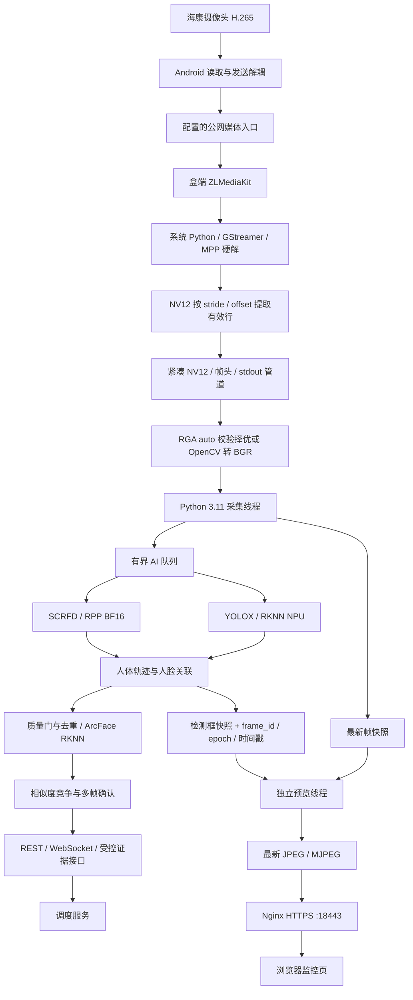

# 机器人寻人识别服务技术方案

版本：2026-10-15 盒端已部署快照。项目：`~/WorkSpace/insightface`。运行镜像
`person-search-rk3588-rpp:box-confirm-20261015-v1`；运行时代码与 `eis100/fba1b6f` 一致。

本文以当前 EIS100 RK3588 容器部署和单路海康实测为基线。描述已实现功能，并单独列出待验证
事项和建议演进；历史 T4、RKNN-only、4K 和双路实验不作为当前性能承诺。现场快照与回滚索引
见 [项目记忆](project-memory.md)。

认证部分已于 2026-10-26 升级：本文下方旧证据 API Key 描述仅代表 10-15 快照，不再适用于
当前配置。现在只接受调度平台签发、带执行器与租约 scope 的 JWT，详见
[统一认证文档](authentication.md)。

## 1. 目标与范围

系统接收目标登记照，在机器人上传的视频中检测、跟踪和识别目标，以同一轨迹的多帧证据确认
身份，再通过事件与查询接口交给调度系统。网页提供带检测框与诊断信息的实时预览。

当前优先场景为一路海康主码流。系统同时保留机器人自带摄像头、双源会话和单源多目标能力；
这些能力不共享同一个性能验收结论。物理移动、摄像头参数下发、公网发布鉴权和机器人推流
属于相邻项目，本服务负责盒端接收后的识别与预览。

| 仓库/组件 | 职责 |
|---|---|
| `swcaresRobot` | 读取海康 RTSP，转发到媒体入口；可发布自带摄像头 |
| 调度服务 | 任务状态、登记/启动/停止识别、机器人指令与识别事件消费 |
| ZLMediaKit | 接收机器人媒体发布，提供 RTSP 等媒体读取接口 |
| 本项目 | 解码桥接、推理、跟踪、身份确认、预览、诊断和短期证据接口 |
| Nginx | HTTPS 入口、页面/API/媒体管理代理及相应入口认证 |

## 2. 总体架构

AI 不必处理每个视频帧，预览也不等待每个视频帧完成识别。AI 队列满时淘汰旧帧，实际处理帧
保持源内时间顺序，但并非逐帧无丢弃。预览叠框来自最近的 AI 状态快照；框超过 400ms 或
跨源 epoch 时不画旧框，因此预览画面并不保证每帧都有框。

## 3. 技术栈与硬件分工

| 层级 | 当前技术与作用 |
|---|---|
| 服务 | Python 3.11、FastAPI、Uvicorn 单 worker、Pydantic Settings |
| 依赖与测试 | `uv` / `uv.lock`、pytest、Ruff |
| 码流读取 | RTSP over TCP；现场取本机 ZLM 的海康来源 |
| 视频解码 | Rockchip MPP，GStreamer `mppvideodec`，输出 NV12 |
| 桥接 | 系统 Python helper → 带帧头的紧凑 NV12 stdout 管道 → Python 3.11 |
| 图像处理 | NV12→BGR 采用 RGA auto 校验择优或 OpenCV；模型输入另做 resize/格式转换 |
| 行人检测 | YOLOX-Tiny RKNN，当前模型输入 640×384 |
| 人脸检测 | SCRFD-10G RPP BF16，搜索 1280×736，登记 640×640 |
| 人脸识别 | ArcFace RKNN，112×112，512 维，flip TTA |
| 跟踪与确认 | ByteTrack 风格两阶段人体关联、人脸兜底跟踪、多帧确认状态机 |
| 网页预览 | 独立 JPEG 编码与 HTTP MJPEG，HTML/JavaScript 监控页 |

MPP 是视频解码单元；RKNN NPU 运行行人检测和身份特征模型；RPP 运行人脸检测模型。
CPU 仍承担调度、部分转换、resize、后处理、对齐、跟踪、相似度计算和 JPEG 编码。
不存在把不同加速器标称 TOPS 相加后直接对应单模型性能的依据。

当前支持通用 ONNX CPU/CUDA、RKNN-only 与 hybrid 后端。本文现场采用 hybrid；T4 部署见
[T4 文档](t4-deployment.md)，原生 RK3588 方案见 [原生部署文档](rk3588-deployment.md)。

## 4. 视频输入与采集

### 4.1 当前相机参数

2026-10-15 实测海康主码流为 H.265、1920×1080、15 FPS、约 2048 kbps CBR。主码流编号
`101` 与分辨率没有一一对应关系，摄像头可配置更高分辨率；子码流 `102` 当时画质不足。
本次没有通过切低清子码流或修改摄像头参数换取预览速度。

源视频当前 15 FPS，预览只能接近这个真实更新率。增大预览限频不会凭空产生新画面；直接把
当前 1080p 改成 4K，也不能由当前数据保证相同解码、传输和识别性能。

### 4.2 硬解和 NV12 桥接

Python 3.11 的 OpenCV wheel 不代表具备盒子的 Rockchip GStreamer 集成。因此使用系统
Python helper 调用 GStreamer，主进程通过自定义帧协议接收数据，保持两套依赖隔离。

硬解缓冲可能有行对齐与平面间隙。实现优先读取逐帧 `GstVideoMeta`，分别复制 Y、UV 有效行；
检查尺寸、平面边界与重叠，缺少 meta 才回退 caps `VideoInfo`。1080p 现场实际缓冲曾为
stride 2304 / UV offset 2488320 / 3732480 bytes，不能按紧凑 3110400 bytes 直接截取。

RGA 转换为可选加速。盒端配置为 `auto`：首次比较 RGA/OpenCV 的颜色与耗时，颜色通过且
RGA 至少快 5% 才选择它；否则使用 OpenCV 并记录原因。设备节点或库可见，只能证明可访问，
不能证明某次会话实际使用了 RGA。

MPP 缓冲在 helper 中映射并按有效行打包，再经 stdout 管道传给主进程；主进程从 NV12 生成
BGR 帧，模型前处理还有 resize、归一化或上传。当前生产路径**没有**把 dma-buf 直接交给
RGA3 做统一的 RGB 640×640 letterbox，也没有将该张量经 memfd 交给独立模型服务。
YOLOX 输入为 640×384，SCRFD 搜索输入为 1280×736，ArcFace 为 112×112；不能用单一
RGB640² 或“全程零拷贝”描述现网。预览 JPEG 只用于显示，不作为推理输入。

### 4.3 缓存、重连与停止

采集保留最新帧快照，同时向容量默认 2 的 AI 队列交付数据。AI 消费变慢时保持有界内存与
更新鲜的输入，预览 latest 独立更新。该机制不能消除摄像头、TCP、jitter buffer 和浏览器
内部的全部缓存，因此还需测帧龄和上游到达间隔。

RTSP 可重连，帧标识与源 epoch 用来区分重连前后的数据。停止必须能中断外部 helper 的阻塞
读取，并确认工作线程退出；不能只设置 stop event 和等待超时，就宣告资源释放完成。

## 5. 识别与确认流水线

1. 登记照执行人脸检测与登记质量门，要求唯一有效人脸；对齐后提取归一化特征。
2. 视频按配置频率运行行人检测、全帧人脸检测及可选头肩 ROI 补检。
3. 行人轨迹维护时序身份，人脸优先按人体空间关系关联；歧义归属不猜测。
4. 人脸检测后先合并去重、检查质量、关联和容量预算，再对保留的人脸执行 ArcFace。
5. 对完整目标身份集合进行归一化向量相似度比较，结合多目标竞争、尺寸档位和多帧证据确认。
6. 发布 candidate / confirmed / lost 等状态事件；shadow 诊断事件保持独立业务含义。

登记与视频使用不同质量要求。人脸尺寸按原始视频帧中的框短边计算，ROI 上采样与网页缩放
不能增加原始身份纹理。

| 身份策略 | 规则说明 |
|---|---|
| 普通脸 ≥80px | 基础默认相似度 0.55、3 帧 / 1.5 秒 |
| 小脸 64–79px | 基础默认相似度 0.60、4 帧 / 2 秒，候选事件更保守 |
| 超小脸 48–63px | 显式开启，较严格质量、投票和聚合门；shadow 不等于正式命中 |
| 小于 48px | 硬底线，不能参与身份确认 |

以上为基础策略说明，不是线上全部最终阈值表。`match_profile`、环境覆盖和迟滞会影响实际
行为；生产验收以会话 `effective_config` 为准。当前 Compose 选择 `transit`，flip TTA 开启，
超小脸启用且保持 shadow；本次性能修复没有降低识别阈值或修改模型。

目标确认后仍保留在身份竞争集合中，防止同一个已命中人物被强制匹配给剩余目标。档位变化、
轨迹丢失和确认样本的时序间隔需共同管理，不能靠单帧高分驱动物理动作。

### 5.1 走过候选与框偏移的当前诊断

2026-10-15 上线前一段单路活动快照中，全帧人体/人脸检测约 3.8–3.9Hz，1416 次累计
人脸观测有 1087 次短边小于 48px。这是整个会话的分布，不代表某个人走过时的逐帧条件。
`candidate` 长时间不转正式确认，需分别看轨迹采样率、原帧人脸尺寸、质量通过数、人体关联、
相似度及未确认门；不能直接通过降阈值处理。框“飘”也需区分预览叠框落后于最新帧与同帧原始
检测框坐标偏移，两者的修复位置不同。

当前 `SearchView` 已暴露 `achieved_sampling_hz`、`unconfirmed_gate_counts`、
`time_to_confirm_p50_seconds` / `time_to_confirm_p95_seconds` 等诊断，预览叠框记录来源
`frame_id`、`source_epoch`、`captured_at`。这些改动改善可观测性和旧框呈现，没有修改检测模型、输入尺寸、相似度门槛、
flip TTA 或确认状态机。要判定原始框精度，仍须同帧比对原图与检测输出。

## 6. RPP 输入与执行优化

### 6.1 已证实的阻塞点

旧 `pyrt.DeviceAllocation.copy_from_numpy` 在拷贝 SCRFD 输入时持有 Python 全局解释器锁。
即使预览在独立线程，它也会连同采集线程一起停顿。单独把同步 execute 改成 enqueue +
释放 GIL 的 stream 等待，仍不能消除输入拷贝造成的停顿。

### 6.2 当前实现

`PERSON_SEARCH_RPP_RELEASE_GIL=true` 时：

1. 为静态输入复用 pinned host buffer，避免每次输入重新分配。
2. 通过 `ctypes.CDLL` 调用 libc memcpy，再调用 SDK rtMemcpy，H2D enum 为 1。
3. enqueue 后通过 CDLL 原生 stream sync 等待；这些 C 调用可释放 GIL。
4. 同步成功后擦除输入 staging，再按既有输出契约读取模型结果。

内存 ABI 显式使用 `c_void_p`、`c_size_t`、`c_int`，校验输入字节数、float32 连续布局与指针
宽度。整个 engine 操作仍受全局 RLock 串行保护，并保留 logger、图权重等借用对象。

copy/enqueue/sync 等结果不明确时，将整个 engine 保留至进程退出，不复用或提前释放可能被
DMA 引用的缓冲。正常关闭顺序为 context → stream → staging 擦除与释放 → 设备/engine/
runtime/owner。通用默认关闭，本次盒端显式开启；不默认启用未经验证的 RPP plan 缓存。

### 6.3 受控硬件验证

独占硬件、相同图和权重、20 次推理 @4Hz 的 A/B/A 对照：

| 指标 | 旧版 A / 重复 A | 新版 B |
|---|---:|---:|
| 输入拷贝 P50 | 91.244 / 91.000 ms | 18.773 ms |
| 完整 engine.run P50 | 123.289 / 123.568 ms | 61.886 ms |
| 5ms 线程心跳最大间隔 | 136.998 / 131.688 ms | 17.163 ms |
| >50ms 心跳停顿 | 20 / 20 次 | 0 次 |

zeros、确定性 random、ones 三组纯合成输入的九个输出逐值相同，最大绝对误差 0。这证明该
传输/等待修改在此模型上的数值一致性；不替代业务场景的误报、漏报或多人人群验收。

## 7. 实时预览方案

预览线程等待新的 latest frame_id，读取最近检测框快照，缩放、叠框并编码 JPEG。
`PreviewHub` 保留最新 JPEG；浏览器以 MJPEG 读取，不让 AI 队列成为预览队列。

叠框只在同一 `source_epoch`、AI 快照不晚于预览帧且框龄不超过 400ms 时显示。超时跳过
旧框并累计 `preview_overlay_stale_frames`；`preview_overlay_age_p95_ms` 记录有效叠框的
年龄。这避免移动的人经过旧位置时继续画框，但不改变原始检测坐标或跟踪精度。

调度以编码开始时刻限频，当前部署目标 15Hz。一次编码已经超出预算时不额外 sleep，也不为
补齐计划频率发送历史帧。无订阅者不编码，停止/断流唤醒线程，空返回不忙循环。

识别读取原帧，不使用网页 JPEG 作为模型输入。预览可以流畅而 AI 调用频率较低；反过来，
AI FPS 正常也不能证明浏览器呈现流畅。

当前 MJPEG 优点是实现简单、容易叠框和兼容浏览器；代价是每帧独立编码，带宽明显高于原
H.265。本次约 6.8 Mbps，对应原视频约 2 Mbps。更换压缩视频预览属于后续演进，不是已完成
功能；需要同时解决浏览器编解码支持、叠框同步、鉴权和真实延迟验收。

## 8. API、会话与敏感数据

| 接口 | 用途 |
|---|---|
| `GET /healthz` | 存活、版本与能力集合 |
| `GET /readyz` | 硬件后端就绪和 embedding contract |
| `POST /v1/targets` | 登记目标照片 |
| `POST /v1/searches` / `/v1/batch-searches` | 创建单目标/批量搜索 |
| `GET /v1/searches/active` | 当前搜索与诊断 |
| `GET /v1/searches/by-request/{request_id}` | 幂等请求对账 |
| `GET /v1/searches/{search_id}` | 指定会话状态 |
| `GET /v1/searches/{search_id}/preview.mjpg` | 预览；多源可指定 source_id |
| `WS /v1/searches/{search_id}/events` | 识别状态事件 |
| `GET/DELETE /v1/searches/{search_id}/evidence/{evidence_id}` | 由任务租约 JWT scope 保护的短期证据读取/释放 |
| `DELETE /v1/searches/active` 或 `/v1/searches/{search_id}` | 停止搜索 |

使用 Uvicorn 单 worker：目标、会话与特征在内存中，直接增加 worker 会造成状态分裂。
请求幂等、替换会话、停止超时和任务终态均需保持生命周期一致。停止未完成时不能提前释放
活动槽位或宣称清理成功。

RTSP 凭据对外脱敏；证据接口使用 `evidence:read` / `evidence:release` JWT scope，提供
短期内存证据与显式释放。
调度如何持久化已授权证据属于它自己的边界。诊断不保存真人帧、登记照、embedding 或证据为
本地素材，日志不包含密钥或完整保护配置。

HTTPS 页面认证、ZLM 管理入口 Basic Auth、ZLM API secret 与执行器 JWT 各有职责，不能
混用。`/mediaserver/` 管理页账号不能直接当作 ZLM 原生 API secret。

## 9. 部署基线与发布步骤

当前容器 `person-search-rk3588-rpp` 监听 18080，经 Nginx 的 18443 入口访问；媒体由独立
`zlmediakit` 容器提供。部署保留 host network/IPC、cpuset 4-7、12 个 bind mount 和 13 个
设备映射。RPP 服务需要共享主机 IPC；MPP 需要可访问设备树、mpp_service 和 dma_heap。

关键运行参数：hybrid、GStreamer、RTSP TCP、NV12、jitter 500ms、drop-on-latency=false、
预览 15Hz、RPP_RELEASE_GIL=true、RPP_ENGINE_CACHE_ENABLED=false。仓库模板和实际保护
配置有覆盖关系，实施操作前核对解析后的 Compose 和实际会话配置。

发布流程：

1. 核对当前任务状态、镜像、运行配置和前一可用回滚版本。
2. 从实际部署 Compose 建立候选配置，逐项比较设备、挂载、CPU、IPC、网络和安全项。
3. 同步打包相关 service、Settings 和 backend 接口；不能只证明本地 HEAD 能 import。
4. 完成测试与硬件输出一致性；若额外进程拿不到 RPP 上下文，在空闲独占条件下验证。
5. 在空闲或已授权中断时切换；验证实际镜像的活动 view、JSON 和查询接口。
6. 检查 healthy/restart、三路 provider、消费者需要的完整能力集合和真实活动任务。
7. 同窗口测试媒体、解码、预览与客户端，检查错误日志，记录版本和回滚路径。

当前镜像和现场回滚脚本位置见 [项目记忆](project-memory.md)。不得回滚到缺 NV12 修复的
旧镜像。保护的 runtime.env 不放宽权限、不打印、不写进仓库；此前通过匿名 memfd 提供给
Compose，TLS 和 SSH 主机校验均保持严格。

## 10. 本次现场验收

| 项目 | 修复前 | 修复后 |
|---|---:|---:|
| ZLM 压缩输出 | 15.027 FPS | 14.981 FPS |
| 独立 NV12 解码 | 14.929 FPS | 14.972 FPS |
| 盒内 MJPEG | 10.947 FPS | 13.937 FPS |
| 盒内 MJPEG 最长间隔 | 264.997 ms | 154.023 ms |
| JPEG 编码 P95（约） | 78 ms | 26 ms |

前后窗口画面不同，不能按严格同画面回放理解。修复后盒内 32 秒无 >200ms 帧间隔。
主服务在 AI 工作量变化时仍持续解码约 15 FPS、预览约 14 FPS。

电脑经 `.30.184:18443` 严格 TLS 读取 32.148 秒，441 帧、13.778 FPS、6.823 Mbps；到达
间隔 P95 201.539ms、最大 303.715ms，24 次 >200ms、0 次 >500ms。该测量增加一个客户端，
不能作为独占带宽测试，也不是浏览器绘制或摄像头到屏幕的光学延迟测量。

原生输入优化阶段验证包括全量 456 项测试、Ruff/diff 检查，以及实际镜像的四种合成活动
状态 × 四个查询路由共 16 次 HTTP200。之后框时序与诊断改动通过 457 项 pytest、Ruff、
`git diff --check` 和监控页 `node --check`；候选镜像再验活动 view/路由均 HTTP200。
2026-10-15 再核对：运行容器 healthy、restart=0；`src/person_search` 的 26 个受 Git 跟踪
运行时 `.py/.html/.js/.css` 文件，加上采集 helper 和健康契约脚本，共 28 个文件与已推送的
`fba1b6f` 逐个 SHA256 一致，且无源码 bind mount 覆盖。镜像早于 Git 提交构建，镜像
revision 仍为发布标识 `box-confirm-20261015-v1`。

用户重启任务后的一次真实单路正样本：1920×1080，decoded 648 / processed 496，终态
`completed`、`found_count=1`；同一轨迹 3/3 证据、最佳相似度 0.653（普通档门槛 0.55）、
采样 4.82Hz，首次证据到正式确认 1.451s。全任务 28 次人脸观测中 20 次短边 <48px，
8 次通过质量门；这些是累计值，不能归到目标走过瞬间。叠框龄 P95 307.9ms、因过期跳过
17 帧；预览帧龄 P95 72.9ms、编码 P95 25.9ms。

结论：已修复一处主要应用线程阻塞，单路真实预览接近 15 FPS 源帧率；上线后这一例目标
在 1.451s 正式确认。前后没有同画面旧版 A/B，尚缺异人负样本、人工同帧框精度观察与长时
稳定性数据，不能推断总体召回、误报或双路/4K 同性能已通过。

## 11. 后续验证与演进

| 顺序 | 工作 | 需要的验收证据 |
|---|---|---|
| 1 | 保持当前单路任务做长时运行 | 多次任务/重连、峰值延迟、积压、错误、CPU/温度趋势 |
| 2 | 同帧核对浏览器叠框与原始检测坐标 | 单订阅者条件、框龄、同帧原图坐标、呈现帧率与光学端到端延迟 |
| 3 | 若带宽仍限制体验，比较压缩视频预览 | 浏览器兼容、鉴权、叠框同步、码率和端到端延迟 |
| 4 | 多次同人及异人走过、移动遮挡与多人回归 | 正负样本、误报/漏报、time-to-confirm、未确认门、轨迹连续性与 shadow 区分 |
| 5 | 用户确需双路或 4K 时单独验收 | 每源指标、共享模型公平性、CPU/内存/网络与业务精度 |

不建议在缺证据时继续加大所有队列、移除模型锁、盲目降低 jitter、打开 RTP 任意丢包或降低
身份确认门槛。每次优化先定位具体阶段，再保留数值一致性、真实任务和回滚证据。

## 12. 代码与运行文档索引

- 协调与预览：[service.py](../src/person_search/service.py)、[video.py](../src/person_search/video.py)。
- 视频桥接：[gstreamer_capture.py](../src/person_search/gstreamer_capture.py)、
  [系统 helper](../scripts/rk3588_gstreamer_capture.py)。
- 加速器：[RPP](../src/person_search/rpp_backends.py)、[hybrid](../src/person_search/hybrid_backends.py)、
  [RKNN](../src/person_search/rknn_backends.py)、[RKNN ABI](../src/person_search/rknn_runtime.py)。
- 契约：[配置](../src/person_search/config.py)、[API](../src/person_search/api.py)、
  [确认策略](../src/person_search/confirmation.py)。
- 部署：[容器说明](rk3588-rpp-container.md)、[Compose](../deploy/person-search-rk3588-rpp.compose.yaml)。
- 排查交接：[项目记忆](project-memory.md)、[经验](../tasks/lessons.md)、[任务记录](../tasks/todo.md)。
